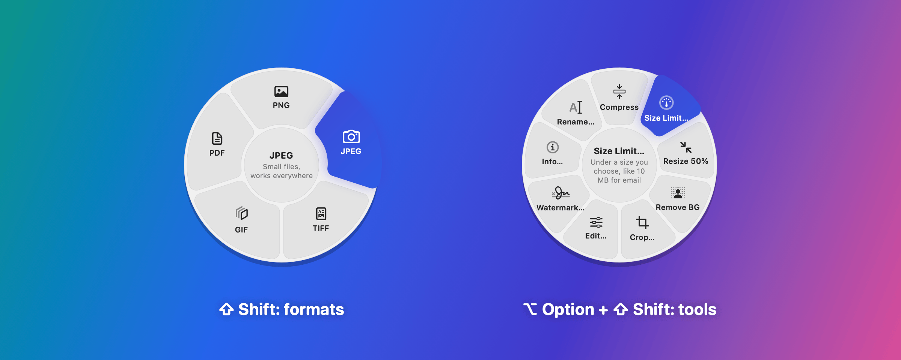
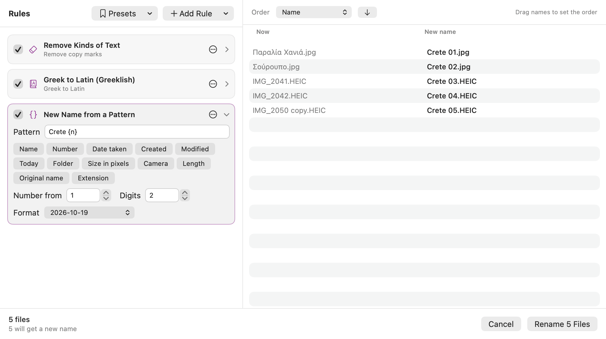

# Pinwheel

**Convert, compress and edit files on your Mac with a drop wheel.**
Start dragging files in Finder, hold **⇧ Shift**, and a wheel of formats
appears under the pointer. Drop the files on one and Pinwheel does the rest.
Hold **⌥ Option** too for the tools, or **⌃ Control** too for file actions
(the keys can be changed). Free, open source, and everything happens on
your Mac: nothing is uploaded.



## What it does

**Convert** (⇧ Shift while dragging)
- Pictures (JPEG, PNG, HEIC, WebP, AVIF, TIFF, GIF, BMP, SVG, camera RAW…)
  → PNG, JPEG, HEIC, WebP, AVIF, TIFF, GIF, BMP, PDF, or icons (ICO for
  Windows, ICNS for the Mac). Several pictures → one PDF, or a **collage**.
  GIFs get the 256 colors that suit the picture, finely mixed (no bands);
  JPEG's see-through parts get the color you choose. Animated pictures keep
  moving as GIF, PNG, HEIC or WebP, or become an **MP4** or **WebM** video.
- Videos (MOV, MP4, M4V; MKV, WebM, AVI, WMV with ffmpeg) → MP4, MOV, MKV,
  WebM, AVI, WMV, GIF, animated WebP, M4A, MP3.
- Audio (MP3, M4A, WAV, AIFF, FLAC, OGG, Opus, WMA…) → MP3, M4A, WAV, AIFF,
  FLAC, OGG, Opus, WMA. Sound that was already compressed keeps at least
  its bit rate.
- PDFs → PNG, JPEG, HEIC or TIFF (one picture per page), a smaller PDF,
  or **Word, Pages, EPUB, Markdown or text** with headings, paragraphs,
  lists, tables, pictures and colors you can edit, two columns where the
  page has them (scans are read too); **Excel** with a
  sheet for each table, numbers as numbers; **PowerPoint** with a slide
  for each page, its words in text boxes you can edit.
- Documents (Word, Pages, RTF, ODT, Markdown, text, web pages, EPUB, old
  .doc) → PDF, Word, Pages, RTF, ODT, Markdown, text, HTML or EPUB, with
  their pictures (Markdown keeps them in a folder beside it).
- Spreadsheets (Excel, Numbers, ODS, CSV, TSV, old .xls) → Excel, ODS, CSV,
  TSV (a file for each sheet) or PDF.
- Slides (PowerPoint, Keynote) → PDF, PowerPoint, or a picture of each
  slide.
- Subtitles: SRT ⇄ WebVTT, with bold, italics, colors and where they go
  on the screen; or just their words (with their times, if you like).
- Archives (ZIP, RAR, 7Z, TAR, TAR.GZ, GZ) → **extracted** into a folder, or
  repacked as ZIP, TAR, TAR.GZ or 7Z.
- Settings › Compatibility has the whole table, and Settings › Wheels
  chooses which formats each kind of file gets.

**Tools** (⌥ Option + ⇧ Shift while dragging)
- **Compress**, and **Size Limit…**: under 10 MB for an email, 25 MB for
  Gmail, or any size, for each file or all together. Pinwheel finds the
  highest quality that fits, and checks.
- **Image editor:** crop to any shape or exact pixels, straighten, adjust
  light and color, 11 filters, remove or replace the background, padding,
  rounded corners and shadows, markup (arrows, text, numbered steps, blur
  out, and faces or text found and blurred by themselves), and watermarks,
  on one picture or many at once.
- **Remove BG:** cuts out people, pets and objects. **Blur Faces & Text**
  hides them all in one go (switch it on in Settings › Wheels › Tools).
- **Video and audio editor:** trim, cut into pieces, crop (1:1, 4:5, 9:16…),
  speed (pitch kept), turn, mute, fades, volume, even out the loudness,
  bleep words, mono or one side only; save a copy, a GIF of the part, or a
  frame.
- **Visualizer…:** a song, podcast or voice note becomes a video with bars
  or a wave moving to the sound, over a picture or a gradient: square,
  wide or tall, to share where only videos go.
- **Rename…** many files at once: replace text, remove characters, numbers,
  dates, case, patterns with the date taken or the camera, Greek to Latin,
  and more, with a live preview. Works on any file or folder.
- **Info…:** see and edit titles, authors, dates and places; remove the
  location or all hidden info.
- **Get Text** from pictures and scanned PDFs, and make scanned PDFs
  **searchable**. Greek too, with Tesseract.
- **Read Codes…:** QR codes and barcodes in pictures; copy the text or open
  the link.
- PDFs: **merge, split, organize** pages (reorder, turn, remove, from
  several PDFs), and **add a password**.
- **Custom actions:** several steps on one wedge, in your order, for
  example *crop 4:5 → fit 1080 px → watermark → JPEG*.

**File actions** (⌃ Control + ⇧ Shift while dragging), for any files and
folders: **AirDrop**, **Copy** (to paste in Finder), **Move To…**, **Copy
Path**, **Terminal** (opened in their folder), **Quick Look**, **Shelf**,
and **ZIP** (everything dropped in one .zip).

**The shelf** is a small floating window to park files on while you find
where they go: drop them on the Shelf wedge (or on the shelf itself), then
drag them off, all at once or one by one. Menu-bar icon › **Shelf** shows
it.

**Clipboard history** (beta): press **⌥⌘V** in any app to see what you
copied, sorted by kind (text, links, images, files) and by the app it came
from, with a search field. Click one (or press Return) and it's pasted
where you were typing (or just copied, if you prefer). Press and hold one
(or press Space) to see all of it, or drag it straight into any app.
**Quick buttons** under a copy paste it as plain text, with clean links
(no tracking), on one line, in other capitals, or the text or QR code in a
picture. A **heart** keeps a copy as a favorite for good, and your own
**collections** ("Work", "Addresses"…) keep copies together: drag a copy
onto one. A kind, Favorites or a collection with nothing in it is left out
of the filters (while you drag a copy, empty ones show, to drop it on). The **anchor** at the bottom keeps the window open while you
work in other apps. The keys, and how many copies to keep (with the room
they take), are in Settings › Clipboard.

**And**
- **Undo** at the top of the menu-bar menu: new files go to the Trash and
  originals come back.
- In Finder: **right-click › Services › Convert with Pinwheel**, **Pinwheel
  Tools**, **Pinwheel File Actions** or **Rename with Pinwheel**.
- In Terminal and Shortcuts: the **`pinwheel` command**.
- New files are saved next to the originals and never overwrite anything:
  `photo (converted).png`, `video (under 25 MB).mp4`.



## Install

You need a Mac with **Apple silicon** and **macOS 26 (Tahoe)** or newer.

1. Download **Pinwheel.zip** from the
   [latest release](https://github.com/IliasPa/Pinwheel_file_converter/releases/latest)
   and double-click it.
2. Move **Pinwheel** to your **Applications** folder and open it.
3. macOS says it can't check Pinwheel for malicious software, because
   Pinwheel isn't notarized (that needs a paid Apple developer account).
   Click **Done**, then open **System Settings › Privacy & Security**, scroll
   down to *"Pinwheel" was blocked…* and click **Open Anyway**. You only do
   this once.
4. Pinwheel opens its Settings and asks for the **Accessibility**
   permission, which it needs to notice Shift and the mouse while you drag.
   Follow the steps there; the section turns green when it's done.

Look for the small wheel in the menu bar. That's it: drag some files, hold
Shift, and drop.

**Optional extras** from [Homebrew](https://brew.sh):
`brew install ffmpeg pngquant tesseract webp`
- **ffmpeg:** MP3, OGG, Opus, WMA, MKV, WebM, AVI and WMV, GIFs from
  videos, and video and audio files macOS can't open.
- **pngquant:** much smaller PNGs with Compress.
- **webp:** WebP pictures (its cwebp makes them).
- **tesseract:** reading Greek text. Then click **Download Greek** in
  Settings › Text Recognition.

Without them everything else works; wedges that need them are grayed out
and say why.

**Pages, Keynote and Numbers** (free on the App Store) open and make what
only they can: Pages and Keynote files, Numbers files, PowerPoint slides,
old .xls spreadsheets, and the Pages format. The first time, macOS asks
whether Pinwheel may use each of them. Word, Excel, PowerPoint (from PDFs),
EPUB, OpenDocument and the rest are written by Pinwheel itself.

**Updates:** menu-bar icon › **Check for Updates…**. Replace the app in
Applications with the new one; your settings stay.

## Using it

| You want to… | Do this |
|---|---|
| Convert | Drag files, hold **⇧ Shift**, drop on a format |
| Use a tool | Drag files, hold **⌥ Option + ⇧ Shift**, drop on a tool |
| AirDrop, copy, move, ZIP… | Drag files, hold **⌃ Control + ⇧ Shift**, drop on an action |
| Choose with the keyboard | With the wheel open: **← →**, then **Return**; **Tab** switches wheels |
| Change your mind | Let go of the keys, press **Esc**, or drop in the middle |
| Use other keys | Settings › Wheels, at the top (and whether the wheel stays open) |
| Choose from Finder | Right-click files › **Services** › **Pinwheel Tools**, then click a wedge |
| Take it back | Menu-bar icon › **Undo …** |
| Paste something you copied before | **⌥⌘V**, then click it (or type to search, ↑↓ and Return) |
| See the original while editing a photo | Hold **Space** (or the Compare button) |

Tools whose names end in "…" open a window where you choose the details
first. The progress window shows each file, the size before and after, and
anything worth knowing; long jobs and anything that couldn't be saved also
get a notification.

**Settings** (menu-bar icon › Settings…) has a page for each part, listed
in a sidebar with a search field:
- **General:** the permission, what happens after converting, where new
  files go, the wheel's glass look, the click sound and the trackpad
  vibration (off, low or high), opening at login.
- **Wheels:** the three wheels and their keys stay at the top; click one
  for its settings below, one kind of file at a time. **Formats** (⇧
  Shift): which formats each kind of file gets, with each format's
  settings (JPEG and HEIC quality, GIF size and length, PDF page
  resolution…). **Tools** (⌥ Option + ⇧ Shift): which tools are on the
  wheel, **custom actions**, and how Compress and Resize work. **File
  actions** (⌃ Control + ⇧ Shift): which are on the wheel, and the
  Terminal app.
- **Compatibility:** a table of every kind of file against every format:
  ✓ it converts (a yellow ✓: something is lost, such as transparency in a
  JPEG; point at it to see what), – it's the same format.
- **Clipboard** (beta): the history on or off, its keys (⌥⌘V), pasting or
  just copying, how a preview opens, the quick buttons, and how many
  copies it keeps.
- **Text Recognition**, **Finder & Shortcuts** (and the `pinwheel`
  command), and **Advanced** (how many files at once, ffmpeg, Reset to
  Defaults).

**The `pinwheel` command** lives inside the app. In Terminal:

```sh
alias pinwheel=/Applications/Pinwheel.app/Contents/Helpers/pinwheel
pinwheel convert jpg ~/Desktop/*.heic
pinwheel size-limit 10MB video.mov
pinwheel run "Instagram" photo.jpg      # one of your custom actions
pinwheel zip ~/Desktop/Trip             # one .zip of a folder
pinwheel extract download.rar
pinwheel convert word report.pdf        # or excel, powerpoint, epub, md…
pinwheel blur ~/Desktop/Screenshot.png  # faces and text blurred out
pinwheel shelf ~/Downloads/*.pdf        # parked on the shelf
pinwheel help
```

In **Shortcuts**, add *Run Shell Script*, set *Pass Input* to *as arguments*
and write `/Applications/Pinwheel.app/Contents/Helpers/pinwheel compress "$@"`.
Switch on *Use as Quick Action › Finder* to have it in Finder's right-click
menu.

## Privacy

Pinwheel converts and edits on your Mac and sends nothing anywhere. It goes
online only when you ask it to: **Check for Updates…** asks GitHub for the
newest version, **Download Greek** gets Tesseract's Greek file from the
Tesseract project, and **Send Feedback…** sends your message (with your
email only if you add it, and Pinwheel's and macOS's version) to the
developer through [formsubmit.co](https://formsubmit.co).

The Accessibility permission is used only to notice the Shift and Option
keys and the mouse while you drag files. Pinwheel never records what you
type. The Automation permission (asked for the first time a file needs
Pages, Keynote or Numbers) is used only to have them open that file and
save a copy.

The clipboard history is kept only on this Mac, in
`~/Library/Application Support/Pinwheel/Clipboard`. What password managers
and other apps mark as private is never kept. Switch it off, or clear it
(favorites and collections stay), in Settings › Clipboard.

## Troubleshooting

**The wheel doesn't appear.** Open Settings and look at the Permission
section. If the switch in System Settings is on but the section stays
orange, click **Reset Permission…** and switch Pinwheel on again.

**"Pinwheel can't be opened".** See step 3 of [Install](#install).

**A wedge is gray.** Hover it: the middle of the wheel says why (usually
"Needs ffmpeg").

**Compress says "Already as small as it gets".** The compressed copy wasn't
clearly smaller, so the original is the better file and nothing was saved.

**Pinwheel isn't in Finder's right-click menu.** It's under **Services** at
the bottom. If not, switch it on in System Settings › Keyboard › Keyboard
Shortcuts › Services › Files and Folders.

**"Pinwheel isn't allowed to use Pages"** (or Keynote, or Numbers). Switch
it on in System Settings › Privacy & Security › Automation › Pinwheel.

**Get Text reads Greek wrong.** Apple's text recognition doesn't read Greek:
install Tesseract and click **Download Greek** in Settings › Text Recognition.

## Ideas and bugs

Menu-bar icon › **Send Feedback…**: write up to 400 characters, and add your
email if you'd like to hear back (whether it was added, if it can't be done,
or when work on it starts). Or open an
[issue on GitHub](https://github.com/IliasPa/Pinwheel_file_converter/issues).
What changed in each version is in [CHANGES.md](CHANGES.md).

## Build it yourself

You need macOS 26 and Apple's **Command Line Tools** (`xcode-select --install`;
no Xcode needed).

```sh
git clone https://github.com/IliasPa/Pinwheel_file_converter.git
cd Pinwheel_file_converter
make install
```

| Command | What it does |
|---|---|
| `make run` | Builds Pinwheel and starts it. |
| `make install` | Builds it, copies it into /Applications, and starts it. |
| `make test` | Runs the tests (about 440, with real conversions). GitHub runs them on every push too. |
| `make release` | Builds and packs `Pinwheel-<version>.zip` for a GitHub release. |
| `make clean` | Deletes all build files. |
| `make icon` | Redraws the app icon from `scripts/make-icon.swift`. |

Builds go to `~/Library/Developer/Pinwheel`, outside the project folder.

**Keeping the Accessibility permission across rebuilds.** macOS treats each
build signed "to run locally" as a new app and forgets the permission. Make a
self-signed certificate once and the build script uses it: open **Keychain
Access › Certificate Assistant › Create a Certificate…**, name it exactly
`Pinwheel Local Signing`, Identity Type *Self Signed Root*, Certificate Type
*Code Signing*. The first build after that asks for your Mac password: click
**Always Allow**.

### How it's built

- **Swift Package Manager**, Swift 6, AppKit and SwiftUI. No other
  dependencies: the work is done by Apple's frameworks (ImageIO, Core Image,
  AVFoundation, PDFKit, Vision, TextKit), with ffmpeg, pngquant, cwebp and
  Tesseract used only when they're installed. Word, Excel, PowerPoint,
  EPUB and OpenDocument files are read and written by Pinwheel's own code
  (`DocumentModel.swift`, `WordDocument.swift`, `Spreadsheet.swift`…).
- `PinwheelCore` is the conversion engine (no user interface).
  `PinwheelUI` is the menu-bar app. `PinwheelWorker` is a small helper the
  app starts for each job, so the memory it used goes back to macOS right
  away and a damaged file can't crash Pinwheel. Started with `--reader`,
  it reads text and codes in pictures (`PictureReader.swift`) and quits a
  minute after its last use. `PinwheelCLI` is the `pinwheel` command.
- The tests make real pictures, videos, songs, PDFs, documents and
  spreadsheets, convert them, and check the results. The ones that use
  Pages, Keynote and Numbers run when asked: `PINWHEEL_IWORK=1 make test`. `Tests/PinwheelUITests/ReadmeImages.swift` draws the
  pictures in this README (`PINWHEEL_README_IMAGES=docs make test`).

## License

[MIT](LICENSE) © 2026 Ilias Paraskevas
